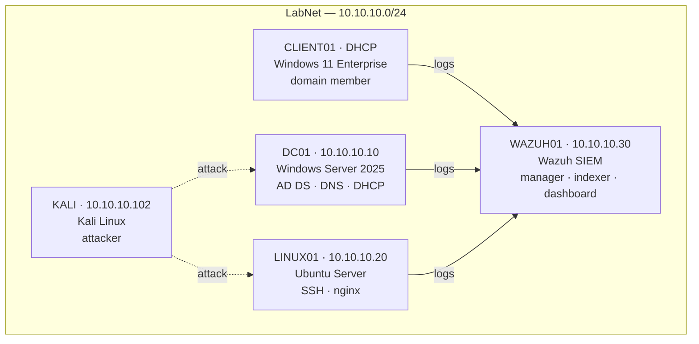

# home-lab-soc

A home lab for learning systems and network administration with a focus on security and monitoring (SOC). The goal was to build a small "company" network from scratch in a virtual environment — an Active Directory domain, Windows and Linux servers, a centralized SIEM — and then run real attacks against it to measure whether monitoring detects them and whether the defenses hold.

The project covers the full cycle: **build infrastructure → monitor → attack → detect → harden → re-verify**.

---

## Contents

- [Architecture](#architecture)
- [Machines](#machines)
- [Technologies](#technologies)
- [Project phases](#project-phases)
- [Attacks and detection](#attacks-and-detection)
- [Hardening](#hardening)
- [What the project taught me](#what-the-project-taught-me)
- [Evidence](#evidence)

---

## Architecture

The whole network runs in VirtualBox, in an isolated NAT network `10.10.10.0/24` (LabNet). DC01 hands out addresses (DHCP) and resolves names (DNS) for the whole domain.

---

## Machines

| Machine | OS | Address | Role |
|---|---|---|---|
| DC01 | Windows Server 2025 | 10.10.10.10 (static) | Domain controller: Active Directory, DNS, DHCP |
| CLIENT01 | Windows 11 Enterprise | DHCP (.100–.200) | Employee workstation, domain member |
| LINUX01 | Ubuntu Server | 10.10.10.20 (static) | Linux server: SSH, nginx web server |
| WAZUH01 | Ubuntu Server + Wazuh | 10.10.10.30 (static) | SIEM: collects and analyzes logs from all machines |
| KALI | Kali Linux | 10.10.10.102 (DHCP) | Attacker (purple team) |

Domain: `lab.local`. Host machine: Windows 11, 24 GB RAM.

---

## Technologies

- **Virtualization:** VirtualBox (NAT Network, snapshots, port forwarding)
- **Windows:** Active Directory Domain Services, DNS, DHCP, Group Policy (GPO), NTFS permissions, Advanced Audit Policy
- **Linux:** SSH and SSH hardening, nginx, ufw firewall, users and permissions (chmod/chown), systemd, journalctl, LVM
- **SIEM:** Wazuh (manager, indexer, dashboard, agents), Active Response, CIS Benchmark (Configuration Assessment)
- **Attack:** nmap, hydra, netexec (crackmapexec)
- **Frameworks:** MITRE ATT&CK, CIS Benchmark

---

## Project phases

### 1. Infrastructure (Windows)
- Set up Windows Server 2025 as a domain controller, built the `lab.local` domain
- Configured DNS and DHCP (the DC hands out addresses and resolves names)
- Created an OU structure, users, department-based groups, and a separate admin account
- Joined a Windows 11 client to the domain
- GPO: block Control Panel (user), logon banner (computer), automatic network drive mapping per group (item-level targeting)
- File server with NTFS permissions per group (access separated by department)

### 2. Infrastructure (Linux)
- Ubuntu Server: static address, SSH, nginx
- Linux administration: users and groups, permissions (chmod 770), services
- Hardening: ufw firewall (only 22 and 80 allowed), SSH hardening (root login disabled, MaxAuthTries)

### 3. Monitoring (SIEM)
- Deployed Wazuh (all-in-one) on a dedicated server
- Installed agents on DC01, CLIENT01, and LINUX01
- Verified the SIEM sees events from every machine (logons, failed logons, changes)

### 4. Attack and detection
- Ran attacks from Kali, tracked in Wazuh (see table below)

### 5. Hardening and re-verification
- Password policy, account lockout, disabled legacy protocols (NTLMv1/LM), SMB signing
- Enabled audit policy (without which the SIEM did not see failed logons on the DC)
- Results verified through Wazuh CIS Configuration Assessment

---

## Attacks and detection

| Attack | Tool | Target | What the SIEM caught |
|---|---|---|---|
| Network scanning | nmap | whole network | Indirectly, via nginx logs on LINUX01 (HTTP 400). Takeaway: reliable scan detection needs a network IDS, not just host-based monitoring |
| SSH brute force | hydra | LINUX01 | Correlated alert (rule 5763, "brute force"), then rule 40112 "Multiple authentication failures followed by a success" (level 12) once the password was cracked. MITRE T1110 |
| SSH brute force (automated defense) | hydra | LINUX01 | Active Response (firewall-drop) automatically blocked the attacker's IP in the firewall for 180s |
| Password spraying on AD | netexec | DC01 | rule 60204 "Multiple Windows Logon Failures" (level 10), rule 60115 "User account locked out" (event 4740, MITRE T1110 + T1531). Lockout policy stopped the attack without any account being cracked |

Key lesson across all attacks: **the SIEM only sees what the system logs.** Failed logons on the domain controller did not appear until Advanced Audit Policy was enabled.

---

## Hardening

Hardening of the Windows domain against the CIS Benchmark for Windows Server 2025. The focus is on concrete security measures and the reason for each, rather than a raw number (the CIS score), since some CIS rules are not relevant to the lab or cannot be met in it.

### Account and password policy
- **Password policy** (14 characters, history 24, complexity, max age 365 days) — makes guessing and reusing passwords harder.
- **Account lockout** (5 attempts / 15 min) — stops brute force and password spraying; in testing it locked the targeted accounts and halted the attack.

### Protocols and encryption
- **Disabled SMBv1** (DC01 + CLIENT01) — a legacy protocol that WannaCry (EternalBlue) spread through. Shared folders kept working over SMBv2/v3.
- **Disabled NTLMv1/LM** (NTLMv2 only) — removes weak, crackable versions of password validation.
- **SMB signing** (client and server) — signs traffic, protecting against interception (MITM).
- **Kerberos: AES only (RC4 disabled)** — RC4 is weak and a target of Kerberoasting; left only AES128/AES256. Domain account logon verified after the change.

### Access and accounts
- **Disabled anonymous enumeration of SAM accounts** — prevents an attacker without an account from pulling the user list.
- **Windows LAPS** — each machine gets a unique, randomized local admin password (20 characters), automatically rotated and stored **encrypted** in Active Directory (readable only by Domain Admins). Prevents lateral movement through a shared local password.

### Audit
- **Advanced Audit Policy** (Account Logon, Logon/Logoff, Account Management) — without it the SIEM did not see failed logons or account lockouts on the DC. Enabling it directly increased attack visibility.

Every finding verified through `net accounts` / `secedit`, `Get-LapsADPassword`, and Wazuh Configuration Assessment (rules moving from *Failed* to *Passed*).

---

## What the project taught me

- Setting up and administering an Active Directory domain (DNS, DHCP, GPO, users, permissions)
- Linux administration and hardening (SSH, firewall, services, permissions)
- Windows hardening against the CIS Benchmark: password and lockout policy, disabling legacy protocols (SMBv1, NTLMv1, RC4), SMB signing, Windows LAPS, audit policy
- Working with a SIEM: collecting logs, writing queries, reading and interpreting alerts, MITRE ATT&CK
- Troubleshooting as the core skill: every problem solved by the pattern **symptom → log → cause → fix** (DNS, clock sync and Kerberos, DHCP server conflict, APT lock, host hypervisor, GPO item-level targeting)
- The link between attack and defense: how an attack looks in the logs, and how hardening (audit, lockout, Active Response) changes the outcome

---

## Evidence

The `dokazi/` folder contains, per attack:
- JSON exports of key Wazuh alerts
- PDF reports generated from the SIEM (Threat Hunting report)
- Screenshots (alerts, locked-out accounts, CIS before/after)
- `napomena.txt` with a description of each attack and the rule IDs it triggered

> The lab was built and attacked entirely in an isolated virtual environment, on my own machines.
