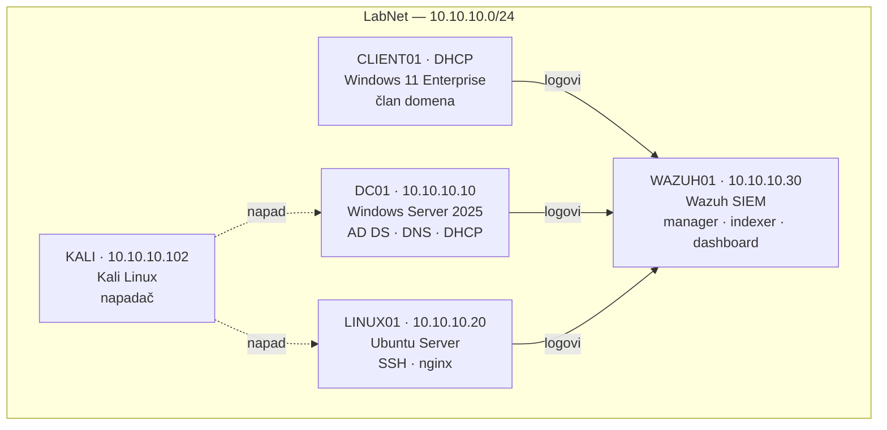

# home-lab-soc

Home lab za učenje administracije sistema i mreža, sa fokusom na bezbednost i nadzor (SOC). Cilj projekta je bio da se od nule izgradi mala "firma" u virtuelnom okruženju: Active Directory domen, Windows i Linux serveri, centralizovani nadzor (SIEM), a zatim da se nad tom mrežom izvedu stvarni napadi i da se izmeri da li ih nadzor prepoznaje i da li odbrana funkcioniše.

Projekat pokriva ceo ciklus: **izgradnja infrastrukture → nadzor → napad → detekcija → hardening → ponovna provera**.

---

## Sadržaj

- [Arhitektura](#arhitektura)
- [Mašine](#mašine)
- [Tehnologije](#tehnologije)
- [Faze projekta](#faze-projekta)
- [Napadi i detekcija](#napadi-i-detekcija)
- [Hardening](#hardening)
- [Čemu me je projekat naučio](#čemu-me-je-projekat-naučio)
- [Dokazi](#dokazi)

---

## Arhitektura

Cela mreža radi u VirtualBox-u, u izolovanoj NAT mreži `10.10.10.0/24` (LabNet). DC01 deli adrese (DHCP) i razrešava imena (DNS) za ceo domen.

---

## Mašine

| Mašina | OS | Adresa | Uloga |
|---|---|---|---|
| DC01 | Windows Server 2025 | 10.10.10.10 (statička) | Domain controller: Active Directory, DNS, DHCP |
| CLIENT01 | Windows 11 Enterprise | DHCP (.100–.200) | Radna stanica zaposlenog, član domena |
| LINUX01 | Ubuntu Server | 10.10.10.20 (statička) | Linux server: SSH, nginx web server |
| WAZUH01 | Ubuntu Server + Wazuh | 10.10.10.30 (statička) | SIEM: skuplja i analizira logove sa svih mašina |
| KALI | Kali Linux | 10.10.10.102 (DHCP) | Napadač (purple team) |

Domen: `lab.local`. Host mašina: Windows 11, 24 GB RAM.

---

## Tehnologije

- **Virtuelizacija:** VirtualBox (NAT Network, snapshotovi, port forwarding)
- **Windows:** Active Directory Domain Services, DNS, DHCP, Group Policy (GPO), NTFS prava, Advanced Audit Policy
- **Linux:** SSH i SSH hardening, nginx, ufw firewall, korisnici i prava (chmod/chown), systemd, journalctl, LVM
- **SIEM:** Wazuh (manager, indexer, dashboard, agenti), Active Response, CIS Benchmark (Configuration Assessment)
- **Napad:** nmap, hydra, netexec (crackmapexec)
- **Okviri:** MITRE ATT&CK, CIS Benchmark

---

## Faze projekta

### 1. Infrastruktura (Windows)
- Postavljen Windows Server 2025 kao domain controller, podignut domen `lab.local`
- Konfigurisani DNS i DHCP (DC deli adrese i razrešava imena)
- Napravljena OU struktura, korisnici, grupe po odeljenjima i poseban admin nalog
- Windows 11 klijent priključen u domen
- GPO: zabrana Control Panela (korisnički), logon banner (računarski), automatsko mapiranje mrežnih diskova po grupama (item-level targeting)
- Fajl server sa NTFS pravima po grupama (pristup odvojen po odeljenjima)

### 2. Infrastruktura (Linux)
- Ubuntu Server: statička adresa, SSH, nginx
- Linux administracija: korisnici i grupe, prava (chmod 770), servisi
- Hardening: ufw firewall (dozvoljeni samo 22 i 80), SSH hardening (zabrana root prijave, MaxAuthTries)

### 3. Nadzor (SIEM)
- Postavljen Wazuh (all-in-one) na zaseban server
- Instalirani agenti na DC01, CLIENT01 i LINUX01
- Potvrđeno da SIEM vidi događaje sa svih mašina (prijave, neuspele prijave, promene)

### 4. Napad i detekcija
- Sa Kalija izvedeni napadi, praćeni u Wazuh-u (vidi tabelu niže)

### 5. Hardening i ponovna provera
- Politika lozinki, zaključavanje naloga, isključeni zastareli protokoli (NTLMv1/LM), SMB signing
- Uključena audit politika (bez koje SIEM nije video neuspele prijave na DC)
- Rezultat verifikovan kroz Wazuh CIS Configuration Assessment

---

## Napadi i detekcija

| Napad | Alat | Meta | Šta je SIEM uhvatio |
|---|---|---|---|
| Skeniranje mreže | nmap | cela mreža | Indirektno, preko nginx logova na LINUX01 (HTTP 400). Zaključak: za pouzdano otkrivanje skeniranja treba mrežni IDS, ne samo host-based nadzor |
| SSH brute force | hydra | LINUX01 | Korelisani alarm (rule 5763, "brute force"), pa rule 40112 "Multiple authentication failures followed by a success" (level 12) kad je lozinka probijena. MITRE T1110 |
| SSH brute force (automatska odbrana) | hydra | LINUX01 | Active Response (firewall-drop) automatski blokirao adresu napadača u firewall-u na 180s |
| Password spraying na AD | netexec | DC01 | rule 60204 "Multiple Windows Logon Failures" (level 10), rule 60115 "User account locked out" (event 4740, MITRE T1110 + T1531). Lockout policy zaustavio napad bez probijanja naloga |

Ključna lekcija kroz sve napade: **SIEM vidi samo ono što sistem zabeleži.** Neuspele prijave na domain controlleru nisu se pojavljivale dok nije uključena Advanced Audit Policy.

---

## Hardening

Hardening Windows domena po CIS Benchmark-u za Windows Server 2025. Fokus je na konkretnim bezbednosnim merama i razlogu zašto se primenjuju, a ne na goloj brojci (CIS skor), jer deo CIS pravila u labu nije relevantan ili se ne može ispuniti.

### Politika naloga i lozinki
- **Politika lozinki** (14 znakova, istorija 24, složenost, max starost 365 dana) — otežava pogađanje i recikliranje lozinki.
- **Zaključavanje naloga** (5 pokušaja / 15 min) — zaustavlja brute force i password spraying; u testu je zaključao napadnute naloge i prekinuo napad.

### Protokoli i enkripcija
- **Isključen SMBv1** (DC01 + CLIENT01) — zastareo protokol kroz koji se širio WannaCry (EternalBlue). Deljeni folderi nastavili da rade preko SMBv2/v3.
- **Isključen NTLMv1/LM** (samo NTLMv2) — uklanja slabe, probijive verzije provere lozinke.
- **SMB signing** (klijent i server) — potpisuje saobraćaj, štiti od presretanja (MITM).
- **Kerberos: samo AES (RC4 isključen)** — RC4 je slab i cilj Kerberoasting napada; ostavljeni samo AES128/AES256. Prijava domenskih naloga verifikovana posle promene.

### Pristup i nalozi
- **Onemogućena anonimna enumeracija SAM naloga** — sprečava da napadač bez naloga izvuče spisak korisnika.
- **Windows LAPS** — svaka mašina ima jedinstvenu, nasumičnu lokalnu admin lozinku (20 znakova), koja se automatski rotira i čuva **šifrovano** u Active Directory (čita je samo Domain Admins). Sprečava bočno kretanje (lateral movement) napadača preko zajedničke lokalne lozinke.

### Audit
- **Advanced Audit Policy** (Account Logon, Logon/Logoff, Account Management) — bez nje SIEM nije video neuspele prijave ni zaključavanja naloga na DC. Uključivanje je direktno povećalo vidljivost napada.

Svaki nalaz verifikovan kroz `net accounts` / `secedit`, `Get-LapsADPassword`, i kroz Wazuh Configuration Assessment (prelazak CIS pravila iz *Failed* u *Passed*).

---

## Čemu me je projekat naučio

- Postavljanje i administracija Active Directory domena (DNS, DHCP, GPO, korisnici, prava)
- Linux administracija i hardening (SSH, firewall, servisi, prava)
- Windows hardening po CIS Benchmark-u: politika lozinki i lockout, isključivanje zastarelih protokola (SMBv1, NTLMv1, RC4), SMB signing, Windows LAPS, audit politika
- Rad sa SIEM-om: prikupljanje logova, pisanje pretraga, čitanje i tumačenje alarma, MITRE ATT&CK
- Troubleshooting kao glavna veština: svaki problem rešavan obrascem **simptom → log → uzrok → rešenje** (DNS, sinhronizacija sata i Kerberos, sukob DHCP servera, APT lock, hipervizor na hostu, GPO ciljanje po grupi)
- Veza između napada i odbrane: kako napad izgleda u logovima i kako hardening (audit, lockout, Active Response) menja ishod

---

## Dokazi

Folder `dokazi/` sadrži, po napadu:
- JSON izvoz ključnih Wazuh alarma
- PDF izveštaje generisane iz SIEM-a (Threat Hunting report)
- Screenshotove (alarmi, zaključani nalozi, CIS pre/posle)
- `napomena.txt` sa opisom svakog napada i uhvaćenih rule ID-eva

> Lab je izgrađen i napadan isključivo u izolovanom virtuelnom okruženju, na sopstvenim mašinama.
